<!--
  Every panel below is an SVG drawn by scripts/build.py. No third-party widgets.

  To change what the panels say:  edit profile.json, then run  python3 scripts/build.py
  Commit City is redrawn daily from live data by .github/workflows/refresh-profile.yml
-->




<!-- quests:start -->
<a href="https://github.com/Raiyan465-F1/kom-bish"></a>
<a href="https://github.com/Raiyan465-F1/gridwise"></a>
<a href="https://github.com/Raiyan465-F1/Maaya"></a>
<a href="https://github.com/Raiyan465-F1/Deadlock-Custom-Match-History"></a>
<a href="https://github.com/Raiyan465-F1/Bracu-RoutineParser"></a>
<a href="https://github.com/Raiyan465-F1/tabRecord"></a>
<!-- quests:end -->

<!-- links:start -->
<a href="https://www.linkedin.com/in/raiyan-rahman-46b778263"></a>
<a href="https://github.com/Raiyan465-F1?tab=repositories"></a>
<!-- links:end -->


